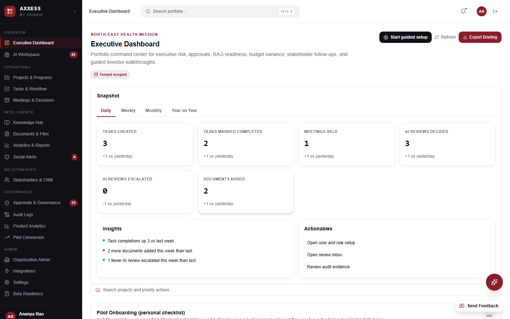

# AXXESS TRIaxis

[](https://github.com/axxess-triaxis/AXXESSTRIAXIS/actions/workflows/ci.yml)
<a href="https://www.producthunt.com/products/axxess-triaxis?embed=true&amp;utm_source=badge-featured&amp;utm_medium=badge&amp;utm_campaign=badge-axxess-triaxis" target="_blank" rel="noopener noreferrer"></a>

AXXESS is the AI workspace for small organisations: tasks, documents, meetings, a CRM and an AI
assistant in one tenant, with a human approving anything risky and every action written to an
audit log. Built by [Triaxis Ventures Private Limited](https://github.com/axxess-triaxis), India.


<sub>Investor demo with demo data, captured 2026-10-30.</sub>

## Try it

- **[investor.triaxisventures.com](https://investor.triaxisventures.com)**: the demo. No sign-in, demo data only.
- **[landing.triaxisventures.com](https://landing.triaxisventures.com)**: the live beta. Sign-in required.

## Status, checked 2026-10-30

| | Status | Evidence |
|---|---|---|
| Web | Live. Both links above return HTTP 200 | `curl`, 2026-10-30 |
| Android | Google Play internal testing (version code 4); open testing submitted for review | [Android closeout, 2026-08-24](docs/readiness/ANDROID_BETA_0_9_MN1_TO_MN8_CONSOLIDATED_CLOSEOUT_2026_08_24.md) |
| Pilots | 2 pilot organisations onboarded on the live beta (July and August 2026); 5 signed letters of intent | [LOI and pilot log](docs/LOIS_BETA_PILOT_INTEREST_REFERRAL_AND_STRATEGIC_PARTNERSHIPS_LOG.md) |
| Prepayment | Both pilots have committed to prepay. One commitment is in writing (2026-08-12); that both are in writing and both pilots are still active is *Founder-stated, source artifact needed* | Same log |
| Revenue | None collected yet. Collection waits on the company's current account and GST registration | [Commercial evidence](docs/audit/08_COMMERCIAL_EVIDENCE.md) |

## Stack

Next.js and React in TypeScript, Supabase (Postgres with row-level security), hosted on Vercel.
The Android app is a Capacitor shell that loads the same web app (`apps/mobile-capacitor`).
AI calls go through a provider-neutral router (`src/services`).

## Run it locally

Needs Node 22+ and pnpm 11+.

```bash
pnpm install --frozen-lockfile
cp .env.example .env.local   # set NEXT_PUBLIC_AXXESS_DEMO_MODE=true to run on demo data
pnpm run dev                 # http://localhost:3000
pnpm run typecheck && pnpm run lint && pnpm run test
```

**Which CI is real:** GitHub Actions ([`.github/workflows`](.github/workflows)) gates every PR; the
badge above is `ci.yml`. `.gitlab-ci.yml` mirrors those checks on a GitLab copy and `bitrise.yml` is
an optional mobile pipeline; neither gates merges here. The app is Next.js. The root `vite.config.ts`
and `index.html` are left over from the first prototype and no script builds them.

## More

- [Previous full README](docs/archive/README_FULL_2026_10_29.md): architecture, governance, sprint history, roadmap, FAQ (archived, not current)
- [How AXXESS fits the other Triaxis products](docs/TRIAXIS_STACK.md)
- [Architecture and business model](MONOREPO_ARCHITECTURE_AND_BUSINESS_MODEL.md) · [Security](SECURITY.md) · [Contributing](CONTRIBUTING.md) · [Licence](LICENSE)
