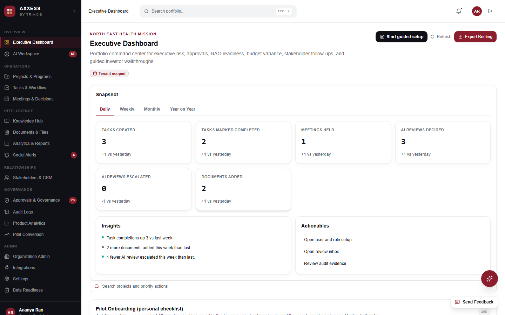

# AXXESS TRIaxis

[](https://github.com/axxess-triaxis/AXXESSTRIAXIS/actions/workflows/ci.yml)
<a href="https://www.producthunt.com/products/axxess-triaxis?embed=true&amp;utm_source=badge-featured&amp;utm_medium=badge&amp;utm_campaign=badge-axxess-triaxis" target="_blank" rel="noopener noreferrer"></a>

AXXESS is the AI workspace for small organisations: tasks, documents, meetings, a CRM and an AI
assistant in one tenant, with a human approving anything risky and every action written to an
audit log. Built by [Triaxis Ventures Private Limited](https://github.com/axxess-triaxis), India.


<sub>Investor demo with demo data, captured 2026-10-30.</sub>

## Try it

- **[landing.triaxisventures.com](https://landing.triaxisventures.com)**: the live app. Sign-in required.
- **[investor.triaxisventures.com](https://investor.triaxisventures.com)**: the demo. No sign-in, demo data only.

## Status

Each row gives the date of its evidence. Only the web row was checked live, on 2026-11-25.

| | Status | As of | Evidence |
|---|---|---|---|
| Web | Live. Both links above return HTTP 200. Every merge to `main` deploys the live app | 2026-11-25 | Live `curl`; [`deploy-production.yml`](.github/workflows/deploy-production.yml) |
| Android | Version 5 (0.9.0) on Google Play: Production track, full rollout, 172 countries and regions | 2026-08-30 | [Android production closeout](docs/readiness/ANDROID_BETA_0_9_PRODUCTION_RELEASE_CLOSEOUT_2026_08_30.md) |
| Pilots | 2 pilot organisations, both onboarded 2026-07-29 | 2026-08-11 | [Claims register](docs/audit/14_CLAIMS_REGISTER.md), row 6 |
| Letters of intent | 5 received, in 3 documents | 2026-08-13 | [LOI and pilot log](docs/LOIS_BETA_PILOT_INTEREST_REFERRAL_AND_STRATEGIC_PARTNERSHIPS_LOG.md) |
| Prepayment | Both pilots have offered an advance: one in writing (2026-08-12), conditional on the company's current account and GST setup, and one orally. That both are now in writing and both pilots are still active is *Founder-stated, source artifact needed* | 2026-08-13 | Same log |
| Revenue | No collected payment is recorded in this repo. Collection waits on the company's current account and GST registration | 2026-08-11 | [Commercial evidence](docs/audit/08_COMMERCIAL_EVIDENCE.md) |

<!-- readme-activity:start (generated; edits here are overwritten) -->
## Recent changes

<sub>Generated 2026-11-25 from this repository's history, last 14 days. Documentation, dependency and housekeeping changes are left out.</sub>

| Date | Change |
|---|---|
| 2026-11-25 | [fix(copilot): validate confirmed actions on the server](https://github.com/axxess-triaxis/AXXESSTRIAXIS/pull/577) |
| 2026-11-25 | [feat(rag): chunk full text, rank fusion and abstention, measured](https://github.com/axxess-triaxis/AXXESSTRIAXIS/pull/575) |
| 2026-11-25 | [Only organization admins can POST /api/rag/evaluation](https://github.com/axxess-triaxis/AXXESSTRIAXIS/pull/576) |
| 2026-11-25 | [Make the RAG release gate run real retrieval](https://github.com/axxess-triaxis/AXXESSTRIAXIS/pull/574) |
| 2026-11-24 | [fix(layout): sidebar and main content scroll separately](https://github.com/axxess-triaxis/AXXESSTRIAXIS/pull/569) |
| 2026-11-24 | [fix(lists): show work lists past 50 rows](https://github.com/axxess-triaxis/AXXESSTRIAXIS/pull/570) |
| 2026-11-24 | [fix(stack): WhatsApp template check that PostgreSQL can evaluate](https://github.com/axxess-triaxis/AXXESSTRIAXIS/pull/571) |
| 2026-11-20 | [feat(stack): Agents card, Message with agent, per-org registration gate](https://github.com/axxess-triaxis/AXXESSTRIAXIS/pull/556) |

And 31 more in the same period.

| Live check | Result |
|---|---|
| https://landing.triaxisventures.com | HTTP 200 |
| https://investor.triaxisventures.com | HTTP 200 |
| https://lite.triaxisventures.com | HTTP 200 |
<!-- readme-activity:end -->

## Lead sourcing

AXXESS finds sales leads, for its own go-to-market and for any organisation on it. There are two ways
in: a hand-picked seed list, where a person approves every lead before it enters the CRM, and
scheduled discovery, where leads are imported automatically and reviewed afterwards. Neither path
enrolls anyone in a sequence or contacts anyone.

| Step | What happens | State |
|---|---|---|
| 1. Seed list | An agent queues a run of company websites through the MCP tool `source_leads`. A founder-maintained exclusion list is checked first | Shipped ([#525](https://github.com/axxess-triaxis/AXXESSTRIAXIS/pull/525)) |
| 2. Crawl | An AWS Lambda worker ([`workers/lead-sourcing`](workers/lead-sourcing/README.md)) claims the run over HTTPS, crawls each site, skips pages that `robots.txt` disallows, and posts back contacts found on the company's own domain | Shipped ([#524](https://github.com/axxess-triaxis/AXXESSTRIAXIS/pull/524) crawler, [#525](https://github.com/axxess-triaxis/AXXESSTRIAXIS/pull/525) worker; fixes [#529](https://github.com/axxess-triaxis/AXXESSTRIAXIS/pull/529), [#532](https://github.com/axxess-triaxis/AXXESSTRIAXIS/pull/532), [#533](https://github.com/axxess-triaxis/AXXESSTRIAXIS/pull/533)) |
| 3. Approve and import | Seed-list runs: `approve_sourced_leads` always needs a fresh human approval; standing grants never cover it, and only approved candidates become CRM leads. The worker never enrolls or contacts anyone | Shipped ([#525](https://github.com/axxess-triaxis/AXXESSTRIAXIS/pull/525)) |
| 4. Schedules and discovery | Users set a schedule on the Lead sourcing page (`/crm/lead-sourcing`). Amazon Bedrock (`openai.gpt-oss-20b-1:0`, ap-southeast-2) finds companies; the crawler finds contacts; candidates are imported automatically for review afterwards, within monthly caps and after the exclusion list | Live in production since 2026-11-19 ([#535](https://github.com/axxess-triaxis/AXXESSTRIAXIS/pull/535), [#536](https://github.com/axxess-triaxis/AXXESSTRIAXIS/pull/536), [#538](https://github.com/axxess-triaxis/AXXESSTRIAXIS/pull/538), [#539](https://github.com/axxess-triaxis/AXXESSTRIAXIS/pull/539), [#540](https://github.com/axxess-triaxis/AXXESSTRIAXIS/pull/540)) |

**First production run, 2026-11-18:** 30 founder-approved seed companies, 26 sites reached,
8 candidates, 7 imported after the founder chose them. Nothing was sent to them. This run was
invoked once by hand, before schedules shipped.
[Closeout](docs/readiness/LEAD_SOURCING_PROD_RUN1_CLOSEOUT_2026_11_18.md) ·
[staging end-to-end test](docs/readiness/LEAD_SOURCING_STAGING_E2E_CLOSEOUT_2026_11_18.md) ·
[agent and MCP design](docs/readiness/LEAD_SOURCING_AGENT_MCP_CLOSEOUT_2026_11_17.md)

**Schedules and discovery, 2026-11-19:** merged to `main` as `afd0c898` and deployed. The first
production schedule (`6bfdb12b`, Dubai real estate brokerages, 10 companies, weekly on Monday 09:00
Asia/Dubai) is on; its first run was due 2026-11-23 at 05:00 UTC. **Its result is not recorded in this repo**
(checked 2026-11-25).
[Closeout](docs/readiness/LEAD_SOURCING_V2_PRODUCTION_CLOSEOUT_2026_11_19.md)

## Stack

Next.js and React in TypeScript, Supabase (Postgres with row-level security), hosted on Vercel.
The Android app is a Capacitor shell that loads the same web app (`apps/mobile-capacitor`).
AI calls go through a provider-neutral router (`src/services`). The lead-sourcing crawler runs on
AWS Lambda, deployed with AWS SAM ([`workers/lead-sourcing/template.yaml`](workers/lead-sourcing/template.yaml)).

## Run it locally

Needs Node 22+ and pnpm 11+.

```bash
pnpm install --frozen-lockfile
cp .env.example .env.local   # set NEXT_PUBLIC_AXXESS_DEMO_MODE=true to run on demo data
pnpm run dev                 # http://localhost:3000
pnpm run typecheck && pnpm run lint && pnpm run test
```

**Which CI is real:** GitHub Actions ([`.github/workflows`](.github/workflows)) runs on every PR; the
badge above is `ci.yml`. GitHub does not require those checks to pass before a merge; the rule that
they must is in [`CLAUDE.md`](CLAUDE.md). `.gitlab-ci.yml` mirrors those checks on a GitLab copy and `bitrise.yml` is
an optional mobile pipeline; neither is used for merges here. The app is Next.js. The root `vite.config.ts`
and `index.html` are left over from the first prototype and no script builds them.

## How status is tracked

Status claims above cite a file or PR in this repo, or a dated live check. Status lives in:

- [Readiness matrix](docs/readiness/ACTIONABLES_READINESS_MATRIX.md): every actionable as `Yes`, `Blocked`, `No` or `Deferred`
- [Decision and outcome ledger](docs/readiness/DECISION_OUTCOME_LEDGER.md): each major decision, its PR and its verification
- `docs/readiness/*_CLOSEOUT_*.md`: one closeout per shipped piece of work

## More

- [Previous full README](docs/archive/README_FULL_2026_10_29.md): architecture, governance, sprint history, roadmap, FAQ (archived, not current)
- [How AXXESS fits the other Triaxis products](docs/TRIAXIS_STACK.md)
- [Architecture and business model](MONOREPO_ARCHITECTURE_AND_BUSINESS_MODEL.md) · [Security](SECURITY.md) · [Contributing](CONTRIBUTING.md) · [Licence](LICENSE)
